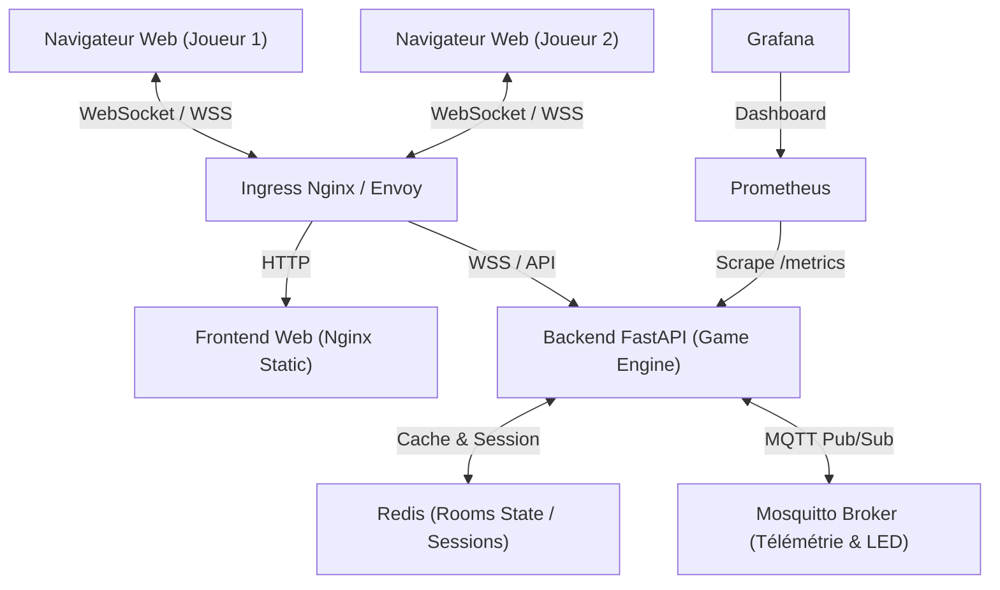

# 📋 Cahier des Charges & Document Stratégique — Sudoku Arena
**Projet :** Sudoku Arena (powered by FRAID)  
**Version :** 1.0.0 — Draft officiel  
**Auteur :** FRAID  
**Date :** Octobre 2026  

---

## 1. 🎯 Vision du Produit & Objectifs

### 1.1 Qu'est-ce que Sudoku Arena ?
**Sudoku Arena** est une plateforme Web moderne de **Sudoku compétitif multijoueur en temps réel**. Elle réinvente le puzzle classique en un jeu d'arcade dynamique alliant rapidité, stratégie, esprit de duel, simulation IoT (ruban LED NeoPixel virtuel) et une architecture microservices Cloud-Native hautement résiliente.

### 1.2 Les 3 Objectifs Majeurs
1. **Expérience Joueur (Fun & Compétition)** : Transformer une activité solitaire en une expérience sociale et palpitante (duels 1v1, mode survie/course, salons privés avec amis, duel contre l'IA *KI FRAID*).
2. **Vitrine Technique & Portfolio DevOps** : Servir de démonstrateur d'ingénierie complet (FastAPI, WebSockets, MQTT/Mosquitto, Docker, Kubernetes, Helm, CI/CD, Observabilité Prometheus/Grafana).
3. **Potentiel de Croissance & Viabilité** : Concevoir un produit prêt pour la monétisation éthique (Freemium, cosmétiques, tournois) dès la phase de conception, sans altérer l'équité sportive.

---

## 2. 💡 Brainstorming : Modèle Économique & Croissance

### 2.1 Règle d'or : Zéro "Pay-to-Win"
Dans un jeu d'esprit et de logique comme le Sudoku, **l'intégrité compétitive est sacrée**. Un joueur ne doit **jamais** pouvoir acheter un avantage mécanique (indices payants en duel, temps supplémentaire payant, etc.).

### 2.2 Les 3 Paliers d'Évolution Économique

```
   ┌──────────────────────────────────────────────────────────────┐
   │ PALIER 1 : Acquisition & Viralité (Gratuit, Zéro Friction)   │
   │  • Pas de compte obligatoire au départ (invitation en 1 clic) │
   │  • 100% gratuit, 0 publicité intrusive                       │
   └──────────────────────────────┬───────────────────────────────┘
                                  ▼
   ┌──────────────────────────────────────────────────────────────┐
   │ PALIER 2 : Freemium Éthique & Personnalisation (Cosmétiques)  │
   │  • Arena Free : Jeu illimité, pubs douces entre les manches  │
   │  • Arena Premium (2,99 €/mois) : Sans pub, thèmes Cyberpunk, │
   │    skins LED personnalisés, stats avancées & heatmaps        │
   └──────────────────────────────┬───────────────────────────────┘
                                  ▼
### 2.4 Extension IA Générative (LLM Assistant & Immersion)
* **Trash-Talk & Ambiance en direct** : KI FRAID ou un bot IA utilise un LLM léger pour envoyer des punchlines et des réactions textuelles en direct dans le chat en fonction des actions du joueur (*« Tu hésites sur le bloc 4 ? Tu transpires déjà ! »*).
* **Coach IA de Fin de Partie (Post-Match Analysis)** : Analyse de la feuille de match par le LLM pour expliquer au joueur ses erreurs, son temps perdu et lui donner un conseil pédagogique d'amélioration.
* **Moteur logique découplé** : La résolution mathématique reste 100% assurée par l'algorithme Python pur (Backtracking instantané < 1ms, 0€ de coût API).

---

## 3. 🎮 Spécifications Fonctionnelles & Gameplay

### 3.1 Les Modes de Jeu

| Mode | Description | Mécanique clé |
| :--- | :--- | :--- |
| **⚡ Mode Clash (Tour par Tour d'origine)** | Les deux joueurs (ou Joueur vs KI) partagent **la même grille**. | Chrono par tour (10s en Difficile, 20s en Moyen, 30s en Facile). **Bon coup** : chiffre validé en vert + points de base + bonus de rapidité. **Erreur ou Fin de chrono** : chiffre rouge/secoué, pénalité de points et **passage immédiat du tour** à l'adversaire. Témoin lumineux (buzzer/LED) indiquant le joueur actif. |
| **🏎️ Mode Course (Speedrun Miroir)** | Chaque joueur résout **sa propre copie identique** du puzzle. | Course de vitesse pure. Jauge de progression adverse en direct (Ghost bar). Le premier à compléter sa grille gagne. |
| **🤖 Mode VS KI FRAID** | Duel contre l'IA sur le Mode Tour par Tour ou Mode Course. | 3 niveaux : *Novice* (délai 5-30s, erreurs), *Tactique* (5-20s), *Grand Maître* (3-10s). |
| **⏱️ Mode Solo / Time Attack** | Entraînement solitaire avec chronomètre global. | Analyse de la régularité et détection de records personnels. |

### 3.2 Modèle Mathématique de Score & Chrono (Héritage du projet d'origine)

#### Barème des Points de Base
| Difficulté | Points de Base (`POINTS`) | Durée max du tour (`TURN_TIMEOUT`) |
| :--- | :---: | :---: |
| **Facile (Easy)** | 1.0 pt | 30 secondes |
| **Moyen (Medium)** | 1.5 pts | 20 secondes |
| **Difficile (Hard)** | 2.0 pts | 10 secondes |

#### Paliers de Bonus de Rapidité (`BONUS_THRESHOLDS`)
Si le coup valide est joué rapidement avant le temps imparti, un bonus s'ajoute :
* **Facile** : `< 10s` ➔ **+1.0 pt** bonus | `< 20s` ➔ **+0.5 pt** bonus
* **Moyen** : `< 7s` ➔ **+1.0 pt** bonus | `< 15s` ➔ **+0.5 pt** bonus
* **Difficile** : `< 5s` ➔ **+1.0 pt** bonus | `< 8s` ➔ **+0.5 pt** bonus

#### Pénalités & Passage de Tour (`SWITCH_PLAYER`)
* En cas d'erreur ou si le chrono du tour expire (timeout) :
  - Déduction d'un point : `max(0, score - 1)`
  - La case s'illumine en **rouge**
  - **Passage immédiat du tour** à l'adversaire (ou à KI FRAID)
* En cas de coup valide :
  - La case se fige en **vert** avec le chiffre
  - Le joueur marque `points_base + bonus_vitesse`
  - Le joueur conserve la main pour continuer son enchaînement !

### 3.3 La Station Virtuelle IoT (Ruban LED NeoPixel)
Héritage direct du projet hardware d'origine (Raspberry Pi + WS2812b) :
* Bandeau LED virtuel immersif intégré en haut de l'écran de jeu.
* **Animations réactives via MQTT/WebSocket** :
  - `🟢 Vert pulsé` : Chiffre correct validé (+ points et bonus).
  - `🔴 Rouge clignotant` : Erreur ou fin de chrono (- pénalité, switch de joueur).
  - `🔵 Bleu balayage` : Témoin lumineux signalant le joueur actif.
  - `🌈 Vague Arc-en-ciel (Rainbow Wipe)` : Victoire finale / Grille complétée.

### 3.4 Optimisations Ergonomiques Neo-Arcade
* **Barre de tension du timer** : Ligne néon lumineuse au-dessus de la grille qui rétrécit pendant le tour et vire au rouge clignotant sous les 3 secondes.
* **Halo de tour interactif** : Badge du joueur actif pulsant en bleu néon avec indicateur sonore à la prise de main.
* **Verrouillage préventif** : Clavier désactivé quand ce n'est pas votre tour pour éviter les clics accidentels.

---

## 4. ⚙️ Spécifications Techniques & Architecture

### 4.1 Architecture Globale



### 4.2 Stack Technologique
* **Backend** : Python 3.11+, FastAPI, Uvicorn, WebSockets natifs, Paho-MQTT, Pydantic v2.
* **Frontend** : HTML5, Vanilla CSS / CSS Custom Properties (Thème Cyberpunk Dark), JavaScript ES6+ moderne (sans dépendances superflues pour une vélocité maximale).
* **Moteur & Algorithme** : Backtracking optimisé, générateur de grilles à solution unique, validateur mathématique instantané.
* **Messagerie & Cache** : Eclipse Mosquitto (ports 1883 TCP & 9001 WebSockets), Redis (état distribué).
* **Conteneurisation & Orchestration** :
  - Multi-stage `Dockerfile` allégé.
  - `docker-compose.yml` pour le cycle de développement local.
  - Manifestes Kubernetes : `Deployment`, `Service` (ClusterIP/NodePort), `ConfigMap`, `Secret`, `Ingress`.
  - Packaging `Helm` chart paramétrable.
* **Observabilité** : Endpoint `/metrics` Prometheus, métriques custom (nombre de parties, latence de validation, erreurs).

### 4.3 Règle d'Arbitrage Anti-Triche (Serveur Autoritaire)
* **Zéro confiance envers le client** : Le client envoie uniquement `(row, col, value)`.
* Le serveur détient la grille solution secrète en mémoire/cache et valide chaque coup.
* L'horloge officielle de la partie est cadencée par le serveur.

---

## 5. 🗺️ Roadmap de Réalisation & Jalons

| Jalon | Intitulé | Livrables clés |
| :--- | :--- | :--- |
| **M1** | **Cœur Algorithmique & Tests** | `sudoku_engine.py` pur, générateur, solver backtracking, bot IA `KI FRAID`, tests `pytest` 100% passants. |
| **M2** | **Backend API & WebSockets** | Serveur FastAPI, gestionnaire de salons en mémoire (`room_manager.py`), synchronisation temps réel. |
| **M3** | **Frontend Neo-Arcade & LED IoT** | Grille responsive tactile/clavier, simulateur LED NeoPixel, sounds FX synthétiques, écran de victoire. |
| **M4** | **Docker & Intégration MQTT** | `Dockerfile`, `docker-compose.yml` (Backend + Frontend + Mosquitto), tests d'intégration locaux. |
| **M5** | **Kubernetes, CI/CD & Production** | Manifestes K8s multi-replicas, test de résilience aux pannes de Pods, workflow GitHub Actions CI. |
| **M6** | **Monétisation & Métriques** | Tableau de bord de rétention, intégration optionnelle thèmes Premium. |

---

## 6. 🎯 Retours Terrain & Spécifications de Raffinement V2

### 6.1 Ergonomie & Affichage « Zéro-Scroll » (Single-Screen Viewport)
* **Contrainte d'affichage stricte** : Le jeu entier (Bandeau LED, Header, Scoreboards, Grille 9x9 et Pavé numérique) doit obligatoirement tenir dans un écran sans aucun défilement vertical (`100dvh` / `overflow: hidden`).
* **Justification Joueur** : En scrollant, le joueur perd de vue la jauge de l'adversaire, le chronomètre néon et les retours lumineux du bandeau LED.

### 6.2 Refonte du Simulateur de Bandeau LED (WS2812b virtuel)
* **Vitesse & Douceur** : Remplacer les impulsions ultrarapides par des transitions douces et progressives (fade-in / fade-out de 400 à 600ms) perceptibles à l'œil nu.
* **Témoin de Prise de Main (Indicateur de Tour)** :
  - Joueur 1 actif : Balayage ou halo bleu néon orienté vers la gauche (côté Joueur 1).
  - Joueur 2 / Bot KI actif : Balayage ou halo violet/bleu orienté vers la droite (côté Joueur 2).
* **Feedback de Validation** :
  - Vert doux pulsé sur coup correct.
  - Rouge doux avec onde de recul sur erreur ou fin de chrono.

### 6.3 Les 2 Modes de Validation de Chiffre
1. **Mode "Casse-Tête" (Strict / Solution Unique)** :
   - Vérification autoritaire par rapport à la grille résolue finale secrète (`solution[row][col] == value`).
   - Idéal pour les puristes et les tournois ELO.
2. **Mode "Simple / Sans Prise de Tête" (Règles Locales)** :
   - Vérifie uniquement que le chiffre respecte les contraintes locales immédiates : pas de doublon sur la ligne, la colonne et le bloc 3x3 actuel (`is_valid_placement(current_grid, row, col, value)`).
   - Accepte le coup même s'il peut mener à une impasse plus tard.
   - Évite la frustration du joueur débutant qui place un chiffre logiquement possible mais rejeté par le serveur.

### 6.4 Analyse de Charge & Surcharge (Scalability & Haute Disponibilité)
* **Sur Northflank Free (Conteneur Unique)** :
  - 1 seule instance (0.1 vCPU, 256 Mo RAM).
  - En cas de pic à 1 000 salons simultanés : saturation CPU, dépassement de mémoire (OOM-Kill) et déconnexion des WebSockets.
* **Sur Architecture Kubernetes Complète (Notre cible K8s)** :
  - Déploiement multi-répliques (3+ Pods) avec `HPA` (Horizontal Pod Autoscaler).
  - Le `Service` / `Ingress LoadBalancer` répartit les connexions WebSockets équitablement.
  - Résilience garantie en production sans aucun crash serveur.

### 6.5 Stratégie de Déploiement Hybride & Démonstration LinkedIn / Portfolio
Afin de concilier démonstration publique immédiate (accessible par les recruteurs en 1 clic) et maîtrise poussée de Kubernetes sans payer d'hébergement cloud :

1. **Environnement A — Jeu Accessible Publiquement (Cloud Managé 100% Gratuit) :**
   - **Frontend :** Vercel Edge (`https://sudoku-arena-frontend.vercel.app`) avec build statique HTML/CSS/JS.
   - **Backend :** Northflank Developer Sandbox (`https://p01--sudoku-backend--hvzj8dcpgjs4.code.run`) avec conteneur FastAPI & WebSockets toujours actif (0.1 vCPU / 256MB).
   - **Bénéfice :** Permet à quiconque d'ouvrir deux onglets ou deux smartphones pour jouer en direct.

2. **Environnement B — Laboratoire Kubernetes Local (Démonstration DevOps / SRE) :**
   - **Cluster :** Docker Desktop avec `kind` (6 pods : 3 réplicas backend, 2 réplicas frontend, 1 broker Mosquitto).
   - **Validation :** Liveness/Readiness probes, self-healing lors d'un pod crash (<2s), manifests K8s et pipeline CI/CD GitHub Actions (`.github/workflows/ci.yml`).
   - **Formulation Portfolio :** *"Projet Full-Stack & DevOps : Déploiement live sur Vercel + Northflank. Pipeline CI/CD GitHub Actions et laboratoire d'orchestration Kubernetes local (manifests multi-réplicas, probes de santé, tests de résilience)."*

3. **Améliorations Ergonomiques & Frontend Validées :**
   - Toast d'alerte explicite affichant la raison du rejet renvoyée par le serveur.
   - Protection de l'état UI : scores et jauges de progression insensibles aux coups invalides ou rejetés.
   - Robustesse WebSocket avec badge d'état réseau et tentatives de reconnexion automatique.
   - Accessibilité complète au clavier (flèches directionnelles 3x3 + 1-9) et ergonomie tactile optimisée.


