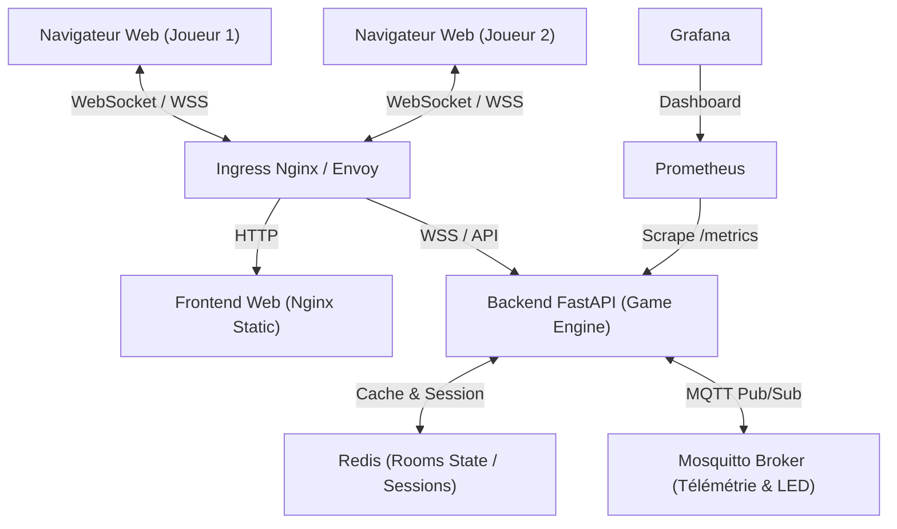

# 📋 Cahier des Charges & Document Stratégique — Sudoku Arena
**Projet :** Sudoku Arena (powered by FRAID)  
**Version :** 1.0.0 — Draft officiel  
**Auteur :** FRAID  
**Date :** Octobre 2026  

---

## 1. 🎯 Vision du Produit & Objectifs

### 1.1 Qu'est-ce que Sudoku Arena ?
**Sudoku Arena** est une plateforme Web moderne de **Sudoku compétitif multijoueur en temps réel**. Elle réinvente le puzzle classique en un jeu d'arcade dynamique alliant rapidité, stratégie, esprit de duel, simulation IoT (ruban LED NeoPixel virtuel) et une architecture microservices Cloud-Native hautement résiliente.

### 1.2 Les 3 Objectifs Majeurs
1. **Expérience Joueur (Fun & Compétition)** : Transformer une activité solitaire en une expérience sociale et palpitante (duels 1v1, mode survie/course, salons privés avec amis, duel contre l'IA *KI FRAID*).
2. **Vitrine Technique & Portfolio DevOps** : Servir de démonstrateur d'ingénierie complet (FastAPI, WebSockets, MQTT/Mosquitto, Docker, Kubernetes, Helm, CI/CD, Observabilité Prometheus/Grafana).
3. **Potentiel de Croissance & Viabilité** : Concevoir un produit prêt pour la monétisation éthique (Freemium, cosmétiques, tournois) dès la phase de conception, sans altérer l'équité sportive.

---

## 2. 💡 Brainstorming : Modèle Économique & Croissance

### 2.1 Règle d'or : Zéro "Pay-to-Win"
Dans un jeu d'esprit et de logique comme le Sudoku, **l'intégrité compétitive est sacrée**. Un joueur ne doit **jamais** pouvoir acheter un avantage mécanique (indices payants en duel, temps supplémentaire payant, etc.).

### 2.2 Les 3 Paliers d'Évolution Économique

```
   ┌──────────────────────────────────────────────────────────────┐
   │ PALIER 1 : Acquisition & Viralité (Gratuit, Zéro Friction)   │
   │  • Pas de compte obligatoire au départ (invitation en 1 clic) │
   │  • 100% gratuit, 0 publicité intrusive                       │
   └──────────────────────────────┬───────────────────────────────┘
                                  ▼
   ┌──────────────────────────────────────────────────────────────┐
   │ PALIER 2 : Freemium Éthique & Personnalisation (Cosmétiques)  │
   │  • Arena Free : Jeu illimité, pubs douces entre les manches  │
   │  • Arena Premium (2,99 €/mois) : Sans pub, thèmes Cyberpunk, │
   │    skins LED personnalisés, stats avancées & heatmaps        │
   └──────────────────────────────┬───────────────────────────────┘
                                  ▼
   ┌──────────────────────────────────────────────────────────────┐
   │ PALIER 3 : Événements, Communautés & B2B                     │
   │  • Tournois inter-écoles / entreprises (Hackathons, soirées) │
   │  • Ligues saisonnières avec cashprize ou lots sponsorisés    │
   └──────────────────────────────────────────────────────────────┘
```

### 2.3 Mécaniques de Viralité intégrées
* **Lobby Instantané par Code & Lien direct** : Un clic sur "Défier un ami" génère un lien (`sudoku-arena.io/join/ABCD`) partageable sur WhatsApp/Discord.
* **Revanche Express** : Bouton immédiat "Prendre sa revanche" qui relance une manche en miroir.
* **Carte de Résultat Partageable** : Image/carte générée automatiquement en fin de partie affichant le chrono, le différentiel de score et la signature visuelle pour Instagram/Twitter/LinkedIn.

---

## 3. 🎮 Spécifications Fonctionnelles & Gameplay

### 3.1 Les Modes de Jeu

| Mode | Description | Mécanique clé |
| :--- | :--- | :--- |
| **🏎️ Mode Course (Speedrun)** | Deux joueurs reçoivent la **même grille miroir** en simultané. | Le premier qui termine sans faute gagne. Visualisation de la barre de progression adverse en direct (effet "Ghost"). |
| **⚡ Mode Clash (Signature)** | Les joueurs s'affrontent sur une **grille partagée au tour par tour** ou en temps réel avec verrouillage temporaire de case. | Chaque bonne case donne des points. Une erreur déclenche un malus et passe la main. Vol de points stratégique. |
| **🤖 Mode VS KI FRAID** | Duel solo contre l'intelligence artificielle du système. | 3 niveaux : *Débutant* (aléatoire avec fautes), *Intermédiaire* (solver partiel avec pause humaine), *Expert* (solver backtracking ultra-rapide). |
| **⏱️ Mode Solo / Time Attack** | Entraînement solitaire avec grille quotidienne et chrono personnel. | Analyse de la régularité, détection de records personnels. |

### 3.2 La Station Virtuelle IoT (Ruban LED NeoPixel)
Héritage direct du projet hardware d'origine (Raspberry Pi + WS2812b) :
* Bandeau LED virtuel immersif intégré en haut de l'écran de jeu.
* **Animations réactives via MQTT/WebSocket** :
  - `🟢 Vert pulsé` : Chiffre correct validé (+ points).
  - `🔴 Rouge clignotant` : Erreur commise (- pénalité temps/score).
  - `🔵 Bleu balayage` : Tour du joueur actif.
  - `🌈 Vague Arc-en-ciel (Rainbow Wipe)` : Victoire finale / Fin de grille.

### 3.3 Gestion des Salons & Joueurs
* **Rôles** : Joueur 1 (Hôte), Joueur 2 (Challenger), Spectateurs (illimités en écoute).
* **Paramètres de Salon** :
  - Difficulté : Facile, Moyen, Difficile, Diabolique.
  - Timer par coup : 15s, 30s, 60s ou Illimité.
  - Malus par erreur : Déduction de points ou gel de jeu pendant 5s.

---

## 4. ⚙️ Spécifications Techniques & Architecture

### 4.1 Architecture Globale



### 4.2 Stack Technologique
* **Backend** : Python 3.11+, FastAPI, Uvicorn, WebSockets natifs, Paho-MQTT, Pydantic v2.
* **Frontend** : HTML5, Vanilla CSS / CSS Custom Properties (Thème Cyberpunk Dark), JavaScript ES6+ moderne (sans dépendances superflues pour une vélocité maximale).
* **Moteur & Algorithme** : Backtracking optimisé, générateur de grilles à solution unique, validateur mathématique instantané.
* **Messagerie & Cache** : Eclipse Mosquitto (ports 1883 TCP & 9001 WebSockets), Redis (état distribué).
* **Conteneurisation & Orchestration** :
  - Multi-stage `Dockerfile` allégé.
  - `docker-compose.yml` pour le cycle de développement local.
  - Manifestes Kubernetes : `Deployment`, `Service` (ClusterIP/NodePort), `ConfigMap`, `Secret`, `Ingress`.
  - Packaging `Helm` chart paramétrable.
* **Observabilité** : Endpoint `/metrics` Prometheus, métriques custom (nombre de parties, latence de validation, erreurs).

### 4.3 Règle d'Arbitrage Anti-Triche (Serveur Autoritaire)
* **Zéro confiance envers le client** : Le client envoie uniquement `(row, col, value)`.
* Le serveur détient la grille solution secrète en mémoire/cache et valide chaque coup.
* L'horloge officielle de la partie est cadencée par le serveur.

---

## 5. 🗺️ Roadmap de Réalisation & Jalons

| Jalon | Intitulé | Livrables clés |
| :--- | :--- | :--- |
| **M1** | **Cœur Algorithmique & Tests** | `sudoku_engine.py` pur, générateur, solver backtracking, bot IA `KI FRAID`, tests `pytest` 100% passants. |
| **M2** | **Backend API & WebSockets** | Serveur FastAPI, gestionnaire de salons en mémoire (`room_manager.py`), synchronisation temps réel. |
| **M3** | **Frontend Neo-Arcade & LED IoT** | Grille responsive tactile/clavier, simulateur LED NeoPixel, sounds FX synthétiques, écran de victoire. |
| **M4** | **Docker & Intégration MQTT** | `Dockerfile`, `docker-compose.yml` (Backend + Frontend + Mosquitto), tests d'intégration locaux. |
| **M5** | **Kubernetes, CI/CD & Production** | Manifestes K8s multi-replicas, test de résilience aux pannes de Pods, workflow GitHub Actions CI. |
| **M6** | **Monétisation & Métriques** | Tableau de bord de rétention, intégration optionnelle thèmes Premium. |
