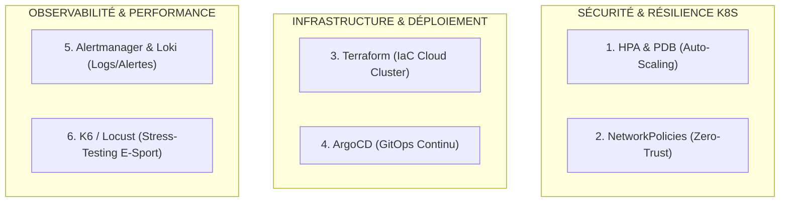

# 📋 Cahier des Charges & Spécifications — Next Steps DevOps (Phase Avancée)
> **Projet :** Sudoku Arena — E-Sport Multiplayer & Cloud-Native Platform  
> **Auteur :** FRAID & Antigravity  
> **Statut :** Planifié / Prêt pour implémentation future après documentation

---

## 🧭 Vue d'Ensemble des 6 Chantiers DevOps

Ce document consigne les spécifications techniques et critères d'acceptation (DoD) des 6 piliers DevOps identifiés pour hisser l'infrastructure de Sudoku Arena au rang de plateforme d'entreprise haute disponibilité.

---

## 1. 📈 K8s Auto-Scaling & Haute Disponibilité (`HPA` & `PDB`)

### 🎯 Objectif
Permettre au backend FastAPI de s'adapter automatiquement aux pics de charge (ex: 200 duels e-sport simultanés) et garantir la disponibilité de l'arène lors des opérations de maintenance du cluster.

### 📝 Spécifications Techniques
1. **Template Helm HPA (`charts/sudoku-arena/templates/hpa.yaml`)** :
   - Cible : `Deployment/backend`.
   - Paramètres : `minReplicas: 3`, `maxReplicas: 10`.
   - Métriques de déclenchement :
     - Utilisation CPU moyenne > **70%**.
     - Utilisation Mémoire moyenne > **80%**.
     - *(Optionnel V3)* : Métrique custom Prometheus (ex: `sudoku_active_rooms > 25`).
2. **Template Helm PDB (`charts/sudoku-arena/templates/pdb.yaml`)** :
   - `minAvailable: 2` (au moins 2 Pods backend opérationnels en permanence lors d'un `kubectl drain` ou rolling-update).

### ✅ Critères d'Acceptation (DoD)
- [ ] Le manifest `hpa.yaml` est activable via `values.yaml` (`backend.autoscaling.enabled: true`).
- [ ] Simulation d'injection de charge CPU déclenchant le passage automatique de 3 à 5+ Pods en moins de 60 secondes.
- [ ] Décroissance progressive (cooldown scale-down de 300s) sans interruption des parties en cours.

---

## 2. 🛡️ Sécurité Réseau & Isolation K8s (`NetworkPolicies` & Gestion des Secrets)

### 🎯 Objectif
Appliquer le principe du moindre privilège (*Zero-Trust Network*) au sein du namespace Kubernetes et sécuriser les credentials sensibles.

### 📝 Spécifications Techniques
1. **NetworkPolicy Redis (`charts/sudoku-arena/templates/networkpolicy-redis.yaml`)** :
   - Bloque tout le trafic entrant vers le port `6379`, **sauf** en provenance des Pods portant le label `app: backend`.
   - Le Frontend et l'Ingress ne doivent avoir aucun accès réseau à Redis.
2. **NetworkPolicy Mosquitto (`charts/sudoku-arena/templates/networkpolicy-mosquitto.yaml`)** :
   - Port 1883 (TCP) restreint au Backend uniquement.
   - Port 9001 (WebSocket) ouvert au Frontend uniquement si la télémétrie client directe est activée.
3. **Chiffrement des Secrets dans Git (`SealedSecrets` ou `External Secrets Operator`)** :
   - Remplacement des variables en clair par des `SealedSecret` chiffrés avec la clé publique du cluster K8s.
   - Protection de `GEMINI_API_KEY` et des tokens d'administration.

### ✅ Critères d'Acceptation (DoD)
- [ ] Un conteneur de test déployé dans le cluster avec `curl` vers `redis:6379` échoue par timeout (accès refusé).
- [ ] Le Backend FastAPI continue de communiquer normalement avec Redis et Mosquitto.
- [ ] Aucun secret en clair n'apparaît dans les commits Git.

---

## 3. 🏗️ Infrastructure as Code — IaC (`Terraform` / `OpenTofu`)

### 🎯 Objectif
Déclarer l'ensemble de l'infrastructure Cloud dans un dossier `terraform/` reproductible en une seule commande (`terraform apply`).

### 📝 Spécifications Techniques
1. **Structure modulaire `terraform/`** :
   - `environments/dev/` et `environments/prod/`.
   - Modules :
     - `modules/k8s_cluster` : Déploiement d'un cluster managé (ex: Civo K3s, Scaleway Kapsule, ou DigitalOcean K8s).
     - `modules/dns` : Déclaration de la zone DNS et du sous-domaine `sudoku.fraid.dev` sur Cloudflare.
     - `modules/helm_release` : Déploiement automatisé du chart `charts/sudoku-arena` sur le cluster fraîchement créé.
2. **Gestion du State distant** :
   - Backend S3 (ou MinIO / Scaleway Object Storage) avec verrouillage DynamoDB / lock.

### ✅ Critères d'Acceptation (DoD)
- [ ] `terraform validate` et `tflint` validés sans erreur.
- [ ] Un environnement complet déployable et destructible proprement (`terraform destroy`).

---

## 4. 🔄 GitOps & Continuous Deployment (`ArgoCD` / `Flux`)

### 🎯 Objectif
Supprimer toute intervention manuelle (`helm install`) pour adopter le standard GitOps déclaratif.

### 📝 Spécifications Techniques
1. **Manifest d'Application ArgoCD (`gitops/application.yaml`)** :
   - Surveille le dépôt `https://github.com/FRAID0/Sudoku-Arena.git` sur la branche `main`.
   - Cible le répertoire `charts/sudoku-arena`.
   - `syncPolicy` :
     - `automated`: `prune: true`, `selfHeal: true`.
     - `syncOptions`: `CreateNamespace=true`.
2. **Gestion des Tags d'Images Automatisée** :
   - Utilisation d'**ArgoCD Image Updater** ou d'un commit bot mettant à jour `values.yaml` (`backend.image.tag: sha-xxxx`) à chaque build réussi par GitHub Actions.

### ✅ Critères d'Acceptation (DoD)
- [ ] Dès qu'un commit est poussé sur `main`, ArgoCD détecte l'état désiré (*Out-of-Sync*) et synchronise le cluster en moins de 30 secondes.
- [ ] L'interface ArgoCD affiche l'arborescence des 10+ ressources K8s en vert (*Healthy*).

---

## 5. 🚨 Alerting & Logs Centralisés (`Alertmanager` + `Loki`)

### 🎯 Objectif
Être notifié en temps réel lors d'une dégradation de service et corréler les métriques aux traces d'erreurs applicatives.

### 📝 Spécifications Techniques
1. **Règles d'Alerte Prometheus (`monitoring/prometheus/alert_rules.yml`)** :
   - `SudokuHighErrorRate` : Taux d'erreurs HTTP 5xx > 2% sur 2 minutes.
   - `SudokuPodCrashLoop` : Plus de 3 redémarrages d'un Pod en 10 minutes.
   - `SudokuRedisDisconnected` : Métrique de connectivité Redis à 0 pendant 30s.
   - `SudokuWebSocketLatencySpike` : Latence de diffusion des coups p95 > 150ms.
2. **Alertmanager (`monitoring/alertmanager/config.yml`)** :
   - Webhook vers un canal **Discord** (#devops-alerts) ou **Slack**.
3. **Stack Loki + Promtail** :
   - Collecte automatique des logs stdout des conteneurs FastAPI et Nginx.
   - Panneau de logs intégré au dashboard Grafana existant.

### ✅ Critères d'Acceptation (DoD)
- [ ] Simuler une panne Redis déclenche une alerte Discord formatée avec lien direct vers le dashboard Grafana.
- [ ] Recherche de logs d'exception FastAPI directement depuis Grafana Explorer.

---

## 6. 🧪 Tests de Charge & Stress Testing E-Sport (`K6` / `Locust`)

### 🎯 Objectif
Prouver scientifiquement la capacité d'absorption de la plateforme avant un grand tournoi en ligne.

### 📝 Spécifications Techniques
1. **Script de Test K6 (`tests/load/k6_clash_duel.js`)** :
   - Simule des paires de joueurs virtuels (VU - Virtual Users) :
     - Scénario 1 : 100 VU créent et rejoignent des salons simultanés.
     - Scénario 2 : Connexion WebSocket persistante, envoi de 40 coups par minute.
     - Scénario 3 : Montée en charge progressive (Ramp-up : 0 ➔ 500 VU en 3 minutes).
2. **Seuils de Performance (SLO / SLA)** :
   - Temps de validation d'un coup < **25ms** au 95ème percentile.
   - 0 échec de handshake WebSocket.
   - Déclenchement vérifié du HPA K8s lors du pic de charge.

### ✅ Critères d'Acceptation (DoD)
- [ ] Rapport HTML K6 généré démontrant la tenue de 500 connexions concurrentes.
- [ ] Graphiques Grafana montrant la corrélation entre les VU K6 et les métriques métier (`sudoku_moves_total`).

---

## 📌 Récapitulatif d'Exécution Recommandé

| Priorité | Chantier | Complexité | Valeur Portfolio / Recruteur |
| :---: | :--- | :---: | :--- |
| **1** | **HPA & PDB (Auto-scaling K8s)** | Faible / Rapide | ⭐️⭐️⭐️⭐️ (Indispensable K8s) |
| **2** | **K6 Stress Testing** | Moyenne | ⭐️⭐️⭐️⭐️⭐️ (Preuve chiffrée de scalabilité) |
| **3** | **NetworkPolicies K8s** | Faible | ⭐️⭐️⭐️⭐️ (Sécurité Cloud-Native) |
| **4** | **Prometheus Alertmanager** | Moyenne | ⭐️⭐️⭐️⭐️ (Observabilité opérationnelle) |
| **5** | **ArgoCD (GitOps)** | Moyenne | ⭐️⭐️⭐️⭐️⭐️ (Standard moderne des équipes DevOps) |
| **6** | **Terraform (IaC)** | Haute | ⭐️⭐️⭐️⭐️⭐️ (Automatisation Cloud complète) |
