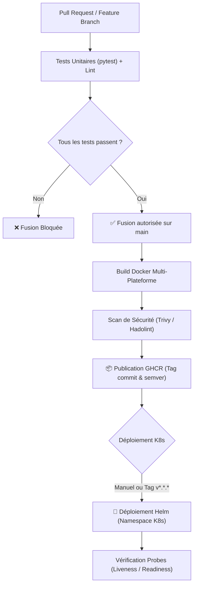
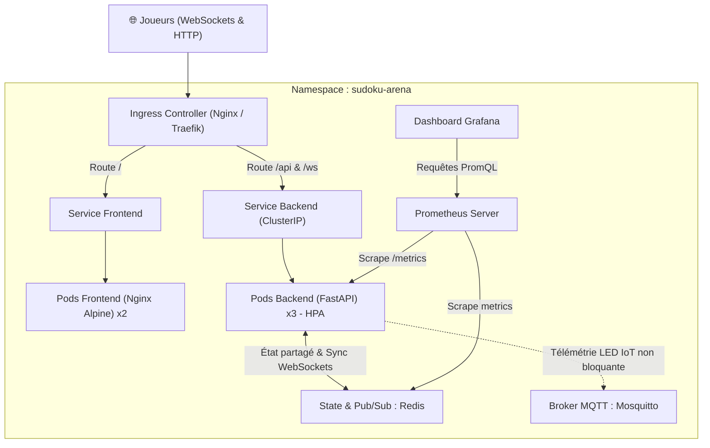

# 🚀 Feuille de Route DevOps & Stratégie Cloud-Native — Sudoku Arena
> **Auteur :** FRAID & Antigravity  
> **Objectif :** Transformer le MVP Sudoku Arena en une vitrine d'ingénierie DevOps complète (Portfolio & Entreprise)  
> **Ordre d'exécution :** GitHub Actions ➔ Jenkins ➔ Kubernetes & Helm ➔ Observabilité (Prometheus / Grafana)  

---

## 1. 🎯 Vision & Philosophie DevOps

### 1.1 Pourquoi deux outils CI/CD (GitHub Actions ET Jenkins) ?
| Outil | Rôle Stratégique & Valeur Portfolio | Usage dans le Projet |
| :--- | :--- | :--- |
| **GitHub Actions** | **Standard Moderne Cloud-Native / Startups** Zéro infrastructure à gérer, intégration native avec GitHub et GHCR. Idéal pour le cycle de développement rapide. | **Pipeline Principal de Production** : Validation PR, lint, tests automatisés, scan de vulnérabilités et publication des images Docker sur GHCR. |
| **Jenkins** | **Standard Industriel / Grandes Entreprises / Secteur Public (DRV Bund, Banques)** Gestion d'infrastructure CI on-premise, agents distribués, gestion fine des credentials et plugins. | **Pipeline Miroir & Pédagogique** : `Jenkinsfile` déclaratif complet exécuté sur un serveur local conteneurisé avec montage du socket Docker hôte. |

> [!IMPORTANT]
> **Règle d'or :** Ne jamais laisser deux pipelines CI/CD déclencher des déploiements automatiques concurrents. GitHub Actions valide et publie les artefacts de release ; Jenkins valide la chaîne déclarative et les tests sur agent dédié.

---

## 2. 🔄 Architecture du Pipeline CI/CD (GitHub Actions)

---

## 3. 🏗️ Architecture Cible Haute Disponibilité (Cluster K8s)

---

## 4. 🧭 Feuille de Route en 4 Phases Opérationnelles

### 📅 PHASE 1 : Pipeline GitHub Actions (La Base de Confiance)
*Objectif : Zéro code non testé ou vulnérable ne rentre sur `main`.*

1. **Workflow de Validation PR (`.github/workflows/ci.yml`)** :
   - Déclenchement sur chaque `pull_request` ciblant `main`.
   - Setup Python 3.12 avec cache pip.
   - Exécution des 17 tests `pytest` et linting (`flake8` / `black`).
   - Permissions minimales `contents: read` sur `GITHUB_TOKEN`.
2. **Workflow de Release & Publication Image (`.github/workflows/release.yml`)** :
   - Déclenchement sur `push: branches: [main]` et sur tags `v*.*.*`.
   - Authentification sécurisée sur `ghcr.io` via `${{ secrets.GITHUB_TOKEN }}`.
   - Build des images `backend` et `frontend` avec `docker/build-push-action` épinglée à des versions immuables.
   - Tagging automatique : `sha-${{ github.sha }}`, `latest` et version sémantique.
   - Scan de vulnérabilités avec **Trivy** (alerte sur failles `HIGH` et `CRITICAL`).

---

### 📅 PHASE 2 : Pipeline Jenkins Déclaratif (L'Atout Grand Compte)
*Objectif : Déployer et maîtriser un serveur CI Jenkins conteneurisé "As-Code".*

1. **Serveur Jenkins Local (`docker-compose.jenkins.yml`)** :
   - Image officielle `jenkins/jenkins:lts-jdk17`.
   - Montage du socket Docker hôte : `-v /var/run/docker.sock:/var/run/docker.sock` pour construire les images sans overhead DinD.
   - Volume persistant pour la configuration : `-v jenkins_data:/var/jenkins_home`.
2. **`Jenkinsfile` Déclaratif à la Racine** :
   - Stages : *Checkout*, *Lint*, *Unit Tests & JUnit Report (`reports/test-results.xml`)*, *Docker Build*, *Security Scan*.
   - Gestion sécurisée des identifiants via le **Jenkins Credentials Store** (zéro secret en dur).
   - Graphiques de tests JUnit intégrés directement dans l'interface de build Jenkins.

---

### 📅 PHASE 3 : Conteneurisation Distribuée, Redis & Kubernetes (Helm)
*Objectif : Rendre le backend 100% sans état (Stateless) pour scaler horizontalement.*

1. **Découplage de l'état avec Redis** :
   - Déplacer la mémoire locale de `room_manager.py` vers un cache Redis partagé.
   - Utiliser **Redis Pub/Sub** pour relayer les messages WebSocket entre les différentes répliques de FastAPI.
2. **Packaging Helm Chart (`charts/sudoku-arena`)** :
   - Paramétrage des `values.yaml` (tags d'images, répliques, ressources CPU/RAM).
   - Définition des sondes Kubernetes :
     - `readinessProbe` sur `/health` (ne route le trafic que si le Pod est prêt).
     - `livenessProbe` sur `/health` (redémarre le conteneur en cas de freeze).
3. **Tests de Résilience (Chaos Engineering)** :
   - Tuer un Pod backend pendant un match et vérifier le redémarrage automatique sans déconnexion grâce à Redis.

---

### 📅 PHASE 4 : Observabilité & Monitoring (Prometheus & Grafana)
*Objectif : Mesurer la performance réelle et superviser l'arène en production.*

1. **Exposition des Métriques Backend** :
   - Intégration du middleware `prometheus-fastapi-instrumentator` sur FastAPI.
   - Endpoint `/metrics` exposant : latence HTTP/WS, nombre de parties en cours, victoires Joueur vs KI FRAID.
2. **Dashboard Grafana Préconfiguré** :
   - Tableau de bord en temps réel :
     - Taux de requêtes / seconde (RPS) et percentiles de latence (p95, p99).
     - État de santé des Pods et consommation mémoire.
     - Métriques métier : Taux d'erreurs moyen par difficulté, répartition des victoires.

---

## 5. 🛡️ Bonnes Pratiques de Sécurité & Robustesse

* **Sécurité de la chaîne logistique logicielle** :
  - Actions GitHub épinglées par SHA commit ou versions majeures vérifiées.
  - Scan continu des images Docker avec Trivy.
  - Dépendances Python auditées (`pip-audit`).
* **Résilience IoT / MQTT** :
  - La télémétrie LED MQTT tourne en tâche de fond découplée ; une coupure de Mosquitto ne bloque **jamais** la validation d'un coup de Sudoku.
* **Propreté du Dépôt Git** :
  - Zéro secret dans Git (`.env.example` versionné, secrets injectés via CI).

---

## 🏁 Prochaine Action dès votre signal :
Dès que vous me donnez le **« GO »**, nous démarrons immédiatement par **l'Étape 1 : Création du workflow GitHub Actions CI (`.github/workflows/ci.yml`)** avec exécution des tests et linting automatique ! 🚀
