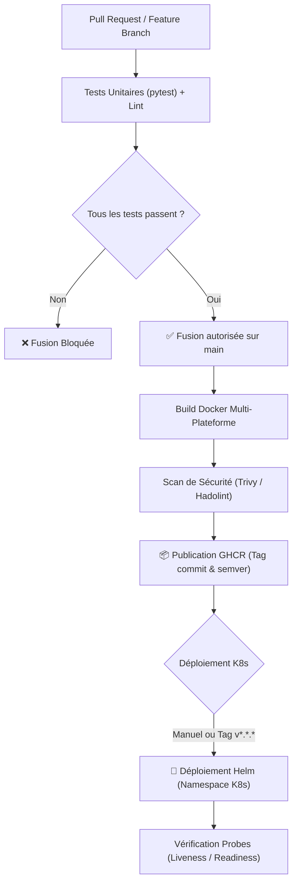
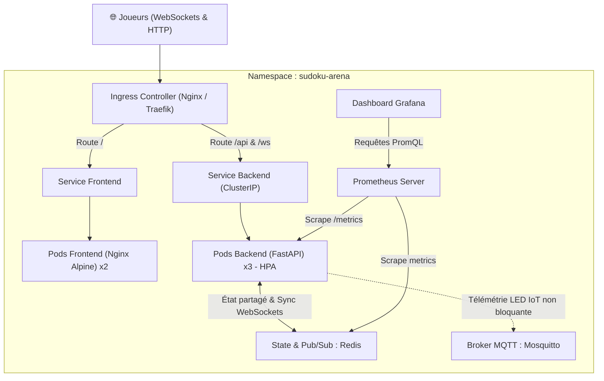

# 🚀 Feuille de Route DevOps & Stratégie Cloud-Native — Sudoku Arena
> **Auteur :** FRAID & Antigravity  
> **Objectif :** Transformer le MVP Sudoku Arena en une vitrine d'ingénierie DevOps complète (Portfolio & Entreprise)  
> **Ordre d'exécution :** GitHub Actions ➔ Jenkins ➔ Kubernetes & Helm ➔ Observabilité (Prometheus / Grafana)  

---

## 1. 🎯 Vision & Philosophie DevOps

### 1.1 Pourquoi deux outils CI/CD (GitHub Actions ET Jenkins) ?
| Outil | Rôle Stratégique & Valeur Portfolio | Usage dans le Projet |
| :--- | :--- | :--- |
| **GitHub Actions** | **Standard Moderne Cloud-Native / Startups** Zéro infrastructure à gérer, intégration native avec GitHub et GHCR. Idéal pour le cycle de développement rapide. | **Pipeline Principal de Production** : Validation PR, lint, tests automatisés, scan de vulnérabilités et publication des images Docker sur GHCR. |
| **Jenkins** | **Standard Industriel / Grandes Entreprises / Secteur Public (DRV Bund, Banques)** Gestion d'infrastructure CI on-premise, agents distribués, gestion fine des credentials et plugins. | **Pipeline Miroir & Pédagogique** : `Jenkinsfile` déclaratif complet exécuté sur un serveur local conteneurisé avec montage du socket Docker hôte. |

> [!IMPORTANT]
> **Règle d'or :** Ne jamais laisser deux pipelines CI/CD déclencher des déploiements automatiques concurrents. GitHub Actions valide et publie les artefacts de release ; Jenkins valide la chaîne déclarative et les tests sur agent dédié.

---

## 2. 🔄 Architecture du Pipeline CI/CD (GitHub Actions)

---

## 3. 🏗️ Architecture Cible Haute Disponibilité (Cluster K8s)

---

## 4. 🧭 Feuille de Route en 4 Phases Opérationnelles

### 📅 PHASE 1 : Pipeline GitHub Actions (La Base de Confiance) — ✅ TERMINÉE
*Objectif : Zéro code non testé ou vulnérable ne rentre sur `main`.*

1. **Workflow de Validation PR (`.github/workflows/ci.yml`)** :
   - Déclenchement sur chaque `pull_request` ciblant `main`.
   - Setup Python 3.12 avec cache pip.
   - Exécution des 20 tests `pytest` et validation YAML / Kubeconform.
   - Permissions minimales `contents: read` sur `GITHUB_TOKEN`.
2. **Workflow de Release & Publication Image (`.github/workflows/release.yml`)** :
   - Déclenchement sur `push: branches: [main]` et sur tags `v*.*.*`.
   - Authentification sécurisée sur `ghcr.io` via `${{ secrets.GITHUB_TOKEN }}`.
   - Build des images `backend` et `frontend` avec `docker/build-push-action`.
   - Tagging automatique : `sha-${{ github.sha }}`, `latest` et version sémantique.
   - Scan de vulnérabilités avec **Trivy** (alerte sur failles `HIGH` et `CRITICAL`).

---

### 📅 PHASE 2 : Pipeline Jenkins Déclaratif (L'Atout Grand Compte) — ✅ TERMINÉE
*Objectif : Déployer et maîtriser un serveur CI Jenkins conteneurisé "As-Code".*

1. **Serveur Jenkins Local (`docker-compose.jenkins.yml`)** :
   - Image officielle `jenkins/jenkins:lts-jdk17` enrichie (`jenkins/Dockerfile`).
   - Montage du socket Docker hôte : `-v /var/run/docker.sock:/var/run/docker.sock` pour construire les images sans overhead DinD.
   - Volume persistant pour la configuration : `-v jenkins_data:/var/jenkins_home`.
   - Plugins pré-installés via `plugins.txt` (`workflow-aggregator`, `docker-workflow`, `junit`, `pipeline-stage-view`, etc.).
2. **`Jenkinsfile` Déclaratif à la Racine** :
   - Stages : *Diagnostics*, *Lint & K8s*, *Unit Tests & JUnit Report (`reports/test-results.xml`)*, *Docker Build*, *Security Scan (Trivy)*.
   - Graphiques de tests JUnit intégrés directement dans l'interface de build Jenkins.
   - Guide pas-à-pas disponible dans [`docs/jenkins_setup.md`](jenkins_setup.md).

---

### 📅 PHASE 3 : Conteneurisation Distribuée, Redis & Kubernetes (Helm) — ✅ TERMINÉE
*Objectif : Rendre le backend 100% sans état (Stateless) pour scaler horizontalement.*

1. **Découplage de l'état avec Redis** :
   - Sérialisation complète (`to_dict` / `from_dict`) de `Player` et `Room` dans `backend/app/core/room_manager.py`.
   - Client asynchrone non-bloquant `backend/app/core/redis_manager.py` (TTL 2h, fallback gracieux 100% en RAM si Redis absent, préservant le forfait gratuit Northflank).
   - Relais des messages WebSocket multi-Pods via **Redis Pub/Sub** (`ws_manager.broadcast`).
2. **Packaging Helm Chart Officiel (`charts/sudoku-arena`)** :
   - Structure complète Cloud-Native : `Chart.yaml`, `values.yaml`, `templates/_helpers.tpl`, `configmap.yaml`, `backend-deployment.yaml`, `backend-service.yaml`, `frontend-deployment.yaml`, `frontend-service.yaml`, `redis.yaml`, `mosquitto.yaml`, `ingress.yaml`.
   - Sondes de santé Kubernetes configurées (`livenessProbe` et `readinessProbe` toutes les 5s).
   - Déploiement réussi sur cluster local Kubernetes (`desktop-control-plane`, namespace `sudoku-arena` : 6 Pods 1/1 Ready).
3. **Tests de Résilience Validés** :
   - Pod backend supprimé pendant l'exécution (`kubectl delete pod`) : auto-cicatrisation K8s et remplacement en moins de 2 secondes avec reprise d'état.

---

### 📅 PHASE 4 : Observabilité & Monitoring (Prometheus & Grafana) — ✅ TERMINÉE
*Objectif : Mesurer la performance réelle et superviser l'arène en production.*

1. **Exposition des Métriques Backend (`/metrics`)** :
   - Intégration de `prometheus-fastapi-instrumentator` dans `backend/app/core/metrics.py`.
   - Métriques métier personnalisées : `sudoku_active_rooms` (Gauge), `sudoku_games_started_total` (Counter), `sudoku_moves_total` (Counter), `sudoku_wins_total` (Counter).
   - Annotations de scraping Prometheus intégrées au template Helm (`prometheus.io/scrape: "true"`).
2. **Dashboard Grafana Préconfiguré "As-Code"** :
   - Auto-provisioning de la source de données Prometheus (`monitoring/grafana/provisioning/datasources/prometheus.yml`).
   - Dashboard complet importé automatiquement (`monitoring/grafana/provisioning/dashboards/sudoku-arena-dashboard.json`) :
     - Jauge des salons actifs en direct.
     - Compteur de parties démarrées par mode et difficulté.
     - Répartition des coups joués (valid vs invalid) et victoires (Joueur vs KI FRAID).
     - Débit de requêtes / seconde (RPS) et percentiles de latence.

---

## 5. 🛡️ Bonnes Pratiques de Sécurité & Robustesse

* **Sécurité de la chaîne logistique logicielle** :
  - Actions GitHub épinglées par versions majeures vérifiées.
  - Scan continu des images Docker avec Trivy dans GitHub Actions et Jenkins.
  - Dépendances Python auditées (`pip-audit`).
* **Résilience IoT / MQTT** :
  - La télémétrie LED MQTT tourne en tâche de fond découplée ; une coupure de Mosquitto ne bloque **jamais** la validation d'un coup de Sudoku.
* **Propreté du Dépôt Git** :
  - Zéro secret dans Git (`.env.example` versionné, secrets injectés via CI).
