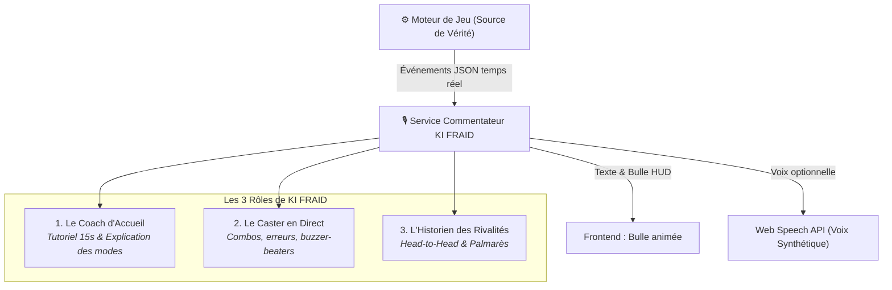

# 🎙️ Vision Gameplay & Commentateur e-Sport — Sudoku Arena
> **Auteur :** FRAID & Antigravity  
> **Statut :** Spécification & Feuille de Route Interactive  
> **Concept Clé :** Transformer un simple Sudoku en une expérience d'arène e-sport vivante, commentée en temps réel par **KI FRAID**.

---

## 1. 🌟 La Vision : Du Casse-Tête au Spectacle e-Sport

Inspiré des plus grandes retransmissions compétitives (studios TV cybernétiques, régies d'esport avec avatars IA et outils d'overlay style *Echo Arena Streaming Tool*), **Sudoku Arena** transcende le jeu de réflexion solitaire.

Chaque match devient un **duel narratif** :
* Une ambiance sonore et visuelle dynamique.
* Un commentateur officiel charismatique : **KI FRAID**.
* Des retournements de situation célébrés à l'écran et à la voix.
* Un historique vivant des rivalités entre joueurs (*"FRAID mène 3-2 face à NeoSolver"*).

---

## 2. 🤖 Le Personnage : KI FRAID, Commentateur Officiel

KI FRAID endosse trois casquettes complémentaires, sans jamais ralentir le moteur de jeu :



### 🔹 Rôle 1 : Le Coach d'Accueil (Onboarding Zéro-Friction)
* Dès l'arrivée d'un nouveau joueur, KI FRAID l'accueille avec enthousiasme :
  > *"Bienvenue dans l'arène ! Choisis ton mode : Course individuelle ou Clash en tour par tour sur la même grille. Prêt à montrer ce que tu as dans le ventre ?"*
* Explique les règles du mode choisi en 2 phrases simples.

### 🔹 Rôle 2 : Le Commentateur Live (Play-by-Play & Color Commentary)
* Réagit aux moments d'intensité :
  * **Combo x2 :** *"OHHH ! Double coup magistral pour FRAID qui creuse l'écart !"*
  * **Erreur critique :** *"Aïe aïe aïe, chiffre invalide ! La main passe immédiatement à l'adversaire !"*
  * **Pression du chrono :** *"Plus que 3 secondes au tour ! Ça panique sur la ligne 4 !"*
  * **Buzzer Beater / Fin de match :** *"Victoire sur le fil avec seulement 0.5 point d'avance !"*

### 🔹 Rôle 3 : L'Historien des Rivalités (Storytelling & Revanches)
* Lorsqu'une revanche est lancée entre deux mêmes joueurs :
  > *"C'est la revanche ! Lors du duel précédent, NeoSolver avait remporté la mise. FRAID parviendra-t-il à égaliser ?"*

---

## 3. ⚔️ Les 3 Variantes du Mode Clash (Choix des Joueurs)

Au lieu d'imposer une règle unique, l'hôte du salon peut choisir la formule qui lui plaît, et le commentateur adapte son discours !

| Variante | Règle du Tour | Profil de Jeu | Narration KI FRAID |
| :--- | :--- | :--- | :--- |
| **Option A : Alternance Stricte** | Chaque joueur joue 1 coup valide ou non, puis la main passe. | Stratégique, calme, équité totale. | *"Coup pour coup, une vraie partie d'échecs."* |
| **Option B : Série Illimitée** | Tant qu'un joueur place un chiffre valide, il garde la main. | Arcade, gros enchaînements, haute tension. | *"3ème chiffre d'affilée ! Il est intouchable, personne ne peut l'arrêter !"* |
| **Option C : Combo Limité (x2)** *(Défaut)* | Coup réussi = droit à 1 coup bonus (max 2 d'affilée), puis passage de main. | **Équilibre Parfait** : récompense l'éclair de génie sans confisquer le match. | *"Double coup validé ! Le chrono est maintenant pour son adversaire !"* |

---

## 4. 🏗️ Architecture Technique : Narration Découplée

```
+--------------------------------------------------------------+
|              BACKEND (FastAPI - Source de Vérité)             |
|  - Vérification des coups (Strict / Simple)                   |
|  - Calcul des points (1.0 à 2.0 + bonus de temps - malus)     |
|  - Émission des événements : COMBO_HIT, TURN_SWITCH, etc.     |
+------------------------------+-------------------------------+
                               | WebSocket
                               v
+--------------------------------------------------------------+
|             COMMENTARY ENGINE (Client / Backend)             |
|  - Filtre d'anti-spam (priorisation des temps forts)          |
|  - Sélection de phrases variées (banque de répliques)         |
|  - Synthèse vocale native : window.speechSynthesis            |
|  - Contrôles utilisateur : [🔊 Voix ON/OFF] [💬 Texte ON/OFF] |
+--------------------------------------------------------------+
```

### Règles d'Or de l'IA Commentateur :
1. **Zéro impact sur la latence du jeu :** La narration est 100% asynchrone ; si la voix met 200ms à démarrer, la validation du coup a déjà eu lieu.
2. **Priorisation & Anti-Bavardage :** Ne pas commenter chaque chiffre anodin pour laisser les joueurs réfléchir.
3. **Respect de l'utilisateur :** Un bouton switch discret en haut de l'écran pour choisir :
   * 🔊 *Voix + Texte* (Immersion totale)
   * 💬 *Texte seul* (Bulle de dialogue discrète)
   * 🔇 *Muet* (Concentration maximale)

---

## 5. 🗺️ Feuille de Route Fonctionnelle

### Phase Gameplay 1 (P0) : Le Moteur de Règles & Les 3 Variantes de Clash
- [ ] Ajouter le paramètre `clash_rule: "combo_capped" | "strict" | "unlimited"` dans la création de salon.
- [ ] Gérer le compteur `combo_streak` dans `RoomManager`.
- [ ] Émettre l'événement `COMBO_STREAK` dans les messages WebSocket.

### Phase Gameplay 2 (P0) : L'Onboarding Zéro-Friction
- [ ] Bouton d'accueil principal : **"Partie Rapide vs KI FRAID"** (lancement en 1 clic).
- [ ] Panneau des règles animé avec présentation des 3 variantes de Clash.
- [ ] Sélecteur de mode clair et intuitif.

### Phase Gameplay 3 (P1) : Le Commentateur KI FRAID (V1 Textuel & Voix Native)
- [ ] Module frontend `commentator.js` avec bibliothèque de phrases dynamiques par événement.
- [ ] Intégration de la Web Speech API (`window.speechSynthesis`).
- [ ] Avatar interactif de KI FRAID dans l'interface de match avec bulles animées.

### Phase Gameplay 4 (P2) : Mémoire des Duels & Statistiques Durables
- [ ] Enregistrement des résultats de match (vainqueur, scores, combos records).
- [ ] Écran récapitulatif post-match avec bouton *"Revanche immédiate"*.
- [ ] Statistiques du face-à-face (*"FRAID vs NeoSolver : Match 2 sur 3"*).
