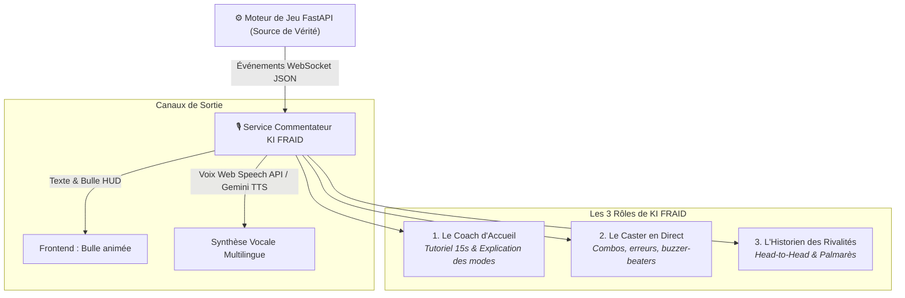

# 🎙️ Vision Gameplay, Commentateur e-Sport & Internationalisation (i18n) — Sudoku Arena
> **Auteurs :** FRAID & Antigravity  
> **Statut :** Spécification de Référence & Feuille de Route Interactive  
> **Concept Clé :** Transformer un simple Sudoku en une expérience d'arène e-sport vivante, commentée en temps réel par **KI FRAID**, accessible en **3 langues (Français 🇫🇷, Anglais 🇬🇧, Allemand 🇩🇪)**.

---

## 1. 🌟 La Vision : Du Casse-Tête au Spectacle e-Sport

Inspiré des plus grandes retransmissions compétitives (studios TV cybernétiques, régies d'esport avec avatars IA et outils d'overlay style *Echo Arena Streaming Tool*), **Sudoku Arena** transcende le jeu de réflexion solitaire.

Chaque match devient un **duel narratif** :
* Une ambiance sonore et visuelle immersive (Cyberpunk / Neo-Arcade).
* Un commentateur officiel charismatique : **KI FRAID**.
* Des retournements de situation célébrés à l'écran et à la voix.
* Un historique vivant des rivalités entre joueurs (*"FRAID mène 3-2 face à NeoSolver"*).
* Une accessibilité internationale native : **Français, Anglais et Allemand**.

---

## 2. 🌍 Architecture Multilingue Native (i18n Trilingue)

L'application entière (interface utilisateur, messages de règles et commentaires vocaux de KI FRAID) est conçue dès le départ pour supporter **3 langues** :
* 🇫🇷 **Français (FR)** : Langue d'origine du créateur et du projet d'école.
* 🇬🇧 **Anglais (EN)** : Standard mondial du jeu vidéo et de l'e-sport international.
* 🇩🇪 **Allemand (DE)** : Marché stratégique européen et atout professionnel pour le portfolio.

Un sélecteur de langue en haut à droite permet de basculer instantanément :
1. Tous les textes UI (boutons, règles, scores, formulaires).
2. La banque de répliques du commentateur KI FRAID.
3. La voix de synthèse vocale (`fr-FR`, `en-US`, `de-DE`).

---

## 3. 🤖 Le Personnage : KI FRAID, Commentateur Officiel

KI FRAID endosse trois casquettes complémentaires, sans jamais ralentir le moteur de jeu :



### 🔹 Rôle 1 : Le Coach d'Accueil (Onboarding Zéro-Friction)
Accueille le joueur, présente les commandes et explique en 2 phrases le mode sélectionné :
* 🇫🇷 *"Bienvenue dans l'arène ! En mode Clash, vous partagez la même grille. Enchaîne les chiffres corrects pour déclencher des combos !"*
* 🇬🇧 *"Welcome to the Arena! In Clash mode, you share the same grid. Chain valid numbers to trigger combos!"*
* 🇩🇪 *"Willkommen in der Arena! Im Clash-Modus teilt ihr euch dasselbe Gitter. Setze richtige Zahlen, um Combos zu starten!"*

### 🔹 Rôle 2 : Le Caster en Direct (Play-by-Play & Color Commentary)
Réagit aux événements marquants avec intensité et intonation adaptée.

### 🔹 Rôle 3 : L'Historien des Rivalités (Storytelling & Revanches)
Rappelle les confrontations passées lorsqu'une revanche est lancée :
* 🇫🇷 *"C'est l'heure de la revanche ! Lors de leur dernier duel, NeoSolver s'était imposé d'un rien. FRAID va-t-il égaliser ?"*
* 🇬🇧 *"Rematch time! Last match was a nail-biter won by NeoSolver. Can FRAID even the score?"*
* 🇩🇪 *"Zeit für die Revanche! Das letzte Duell ging hauchdünn an NeoSolver. Kann FRAID ausgleichen?"*

---

## 4. 📚 Catalogue de Commentaires Réactifs (Minimum 2 Variantes par Événement)

Pour éviter la répétition monotone, le moteur utilise un **sac de tirage sans répétition immédiate** (*Shuffle Bag*) avec au minimum 2 variantes par événement :

| Événement | 🇫🇷 Français | 🇬🇧 Anglais | 🇩🇪 Allemand |
| :--- | :--- | :--- | :--- |
| **WELCOME**<br>*(Accueil)* | **V1:** « Bienvenue dans l'arène ! »<br>**V2:** « Le public est chaud, à toi de jouer ! » | **V1:** "Welcome to the Arena!"<br>**V2:** "The crowd is hyped, make your move!" | **V1:** « Willkommen in der Arena! »<br>**V2:** « Das Publikum ist bereit, du bist am Zug! » |
| **MOVE_VALID**<br>*(Coup réussi)* | **V1:** « Bien joué, ce coup est validé ! »<br>**V2:** « Précision chirurgicale ! » | **V1:** "Nicely played, move confirmed!"<br>**V2:** "Surgical precision! You score points." | **V1:** « Starker Zug, Zahl bestätigt! »<br>**V2:** « Chirurgische Präzision! Punkte gesichert. » |
| **COMBO_X2**<br>*(Double coup)* | **V1:** « Deux coups réussis ! Quel enchaînement ! »<br>**V2:** « Combo x2 ! Tu gardes la pression ! » | **V1:** "Two in a row! What a combo!"<br>**V2:** "Combo x2! Keeping the pressure on!" | **V1:** « Doppelter Treffer! Was für ein Lauf! »<br>**V2:** « Combo x2! Der Druck steigt! » |
| **MOVE_INVALID**<br>*(Erreur)* | **V1:** « Aïe ! La main change de camp ! »<br>**V2:** « Cette erreur coûte cher. L'adversaire reprend la main ! » | **V1:** "Ouch! Turn handed over!"<br>**V2:** "Costly mistake! Rival takes the turn!" | **V1:** « Autsch! Der Zug wechselt! »<br>**V2:** « Teurer Fehler! Der Gegner übernimmt! » |
| **TIMEOUT**<br>*(Temps écoulé)* | **V1:** « Le chrono vient de tomber à zéro ! »<br>**V2:** « Trop tard ! L'adversaire récupère le tour. » | **V1:** "Clock hit zero! Time's up!"<br>**V2:** "Too slow! Turn goes to the opponent." | **V1:** « Die Zeit ist abgelaufen! »<br>**V2:** « Zu spät! Der Gegner ist wieder am Zug. » |
| **GAME_OVER_WIN**<br>*(Victoire)* | **V1:** « Victoire ! Tu remportes ce duel ! »<br>**V2:** « Quelle performance ! L'arène a son champion ! » | **V1:** "Victory! You take the match!"<br>**V2:** "Incredible performance! We have our champion!" | **V1:** « Sieg! Du gewinnst dieses Duell! »<br>**V2:** « Wahnsinnsleistung! Die Arena hat ihren Champion! » |
| **GAME_OVER_LOSS**<br>*(Défaite)* | **V1:** « Beau combat, mais la victoire s'échappe ! »<br>**V2:** « Défaite amère, la revanche s'impose ! » | **V1:** "Great fight, but victory slipped away!"<br>**V2:** "Tough loss, time for a rematch!" | **V1:** « Guter Kampf, aber knapp verpasst! »<br>**V2:** « Bittere Niederlage, Zeit für eine Revanche! » |

---

## 5. 🏗️ Architecture Hybride à 3 Niveaux de Narration

```
[ Niveau 1 : Catalogue Local ] ────► Instantané, 0 latence, 100% hors-ligne, gratuit (Français / Anglais / Allemand)
              │
              ▼
[ Niveau 2 : Web Speech API ] ────► Voix native du navigateur (window.speechSynthesis)
              │
              ▼
[ Niveau 3 : Gemini Flash AI ] ───► Introductions procédurales épiques, analyses de rivalités et résumés de match
```

### 1. Niveau 1 — Catalogue Local Réactif (Fondation Solide)
* Tableau JSON local avec sélection pseudo-aléatoire sans répétition.
* Zéro coût, zéro appel réseau, temps de réponse = **0 milliseconde**.
* Fonctionne même si l'utilisateur est hors-ligne ou si le réseau vacille.

### 2. Niveau 2 — Synthèse Vocale Native (Web Speech API)
* Utilisation de l'API standard `window.speechSynthesis`.
* Sélection automatique de la voix de l'appareil selon la langue active :
  * Français : `fr-FR`
  * Anglais : `en-US` ou `en-GB`
  * Allemand : `de-DE`
* Contrôles utilisateur clairs :
  * 🔊 **Voix + Texte** (Immersion totale)
  * 💬 **Texte seul** (Sous-titres discrets sans audio)
  * 🔇 **Muet** (Mode silence)

### 3. Niveau 3 — Intelligence Générative (Google Gemini Flash)
* Utilisé uniquement à des moments clés (avant-match et débriefing post-match), jamais pendant la validation d'un coup pour ne pas impacter la réactivité.
* Génère des résumés stylisés e-sport : *"FRAID a dominé le premier tiers de la grille avec 2 combos décisifs..."*.

---

## 6. ⚔️ Les 3 Variantes de Clash au Choix des Joueurs

| Variante | Règle du Tour | Profil de Jeu | Statut |
| :--- | :--- | :--- | :--- |
| **Option A : Alternance Stricte** (`strict`) | 1 coup chacun, tour après tour. | Réfléchi, calme, jeu d'échecs. | ✅ Implémenté backend |
| **Option C : Combo Limité** (`combo_capped`) *(Défaut)* | Coup valide = 1 coup bonus (max 2 d'affilée), puis passage. | **Équilibre Parfait** : dynamisme sans monopole. | ✅ Implémenté backend |
| **Option B : Série Illimitée** (`unlimited`) | Tant qu'on valide, on garde la main. | Arcade, adrénaline pure, risque de snowball. | ✅ Implémenté backend |

---

## 7. 🎬 Séquence d'Immersion d'Avant-Match (5 Secondes)

Comme lors d'une retransmission sportive e-sport :
1. **Seconde 0-2 :** KI FRAID salue les joueurs et affiche les pseudos et les statistiques de face-à-face.
2. **Seconde 2-3 :** Rappel de la règle active (ex: *"Mode Clash • Combo x2 activé"*).
3. **Seconde 3-5 :** Décompte synchronisé sonore et visuel : **« 3.. 2.. 1.. GO ! »** (ruban LED passe en bleu/cyan).
4. Bouton **« Passer l'intro »** pour les joueurs pressés.

---

## 8. 🗺️ Feuille de Route d'Exécution

| Phase | Intitulé | Tâches & Livrables | Statut |
| :--- | :--- | :--- | :--- |
| **Phase G1** | **Moteur de Règles Clash & Combos** | `ClashRule` (strict, combo_capped, unlimited), streak tracking, 27 tests unitaires. | ✅ **TERMINÉE** |
| **Phase G2** | **Catalogue Trilingue & Module Commentateur** | Création de `frontend/commentator.js` avec catalogue FR/EN/DE, Web Speech API et sélecteur de langue. | 🎯 **EN COURS** |
| **Phase G3** | **Onboarding Zéro-Friction & UI Avatar** | Bouton « Jouer vs KI FRAID » en 1 clic, bulles animées de l'avatar et sélecteur de variantes. | ⏳ Prochaine étape |
| **Phase G4** | **Mémoire des Matchs & Résumés IA** | Historique des duels, bouton de revanche rapide, résumés Gemini post-match. | ⏳ Futur |
