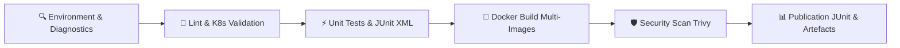

# 🏗️ Guide de Déploiement & Utilisation — Jenkins CI Declarative Pipeline

> **Projet :** Sudoku Arena  
> **Composant :** Serveur CI Jenkins conteneurisé & `Jenkinsfile` Déclaratif  
> **Accès Web :** [http://localhost:8085](http://localhost:8085)  

---

## 1. 🎯 Présentation & Valeur Portfolio

Dans les environnements d'entreprise et les grands comptes (banques, assurances, secteur public, DRV Bund), **Jenkins** demeure le standard de référence pour l'automatisation de pipelines CI/CD complexes on-premise.

Ce setup fournit une implémentation **100% "As-Code"** comprenant :
1. **Un serveur Jenkins LTS conteneurisé** ([`docker-compose.jenkins.yml`](../docker-compose.jenkins.yml)) avec plugins préinstallés et accès direct au socket Docker hôte.
2. **Un pipeline déclaratif complet** ([`Jenkinsfile`](../Jenkinsfile)) couvrant :
   - Le linting et la validation des manifestes Kubernetes.
   - L'exécution des 20 tests unitaires Pytest avec génération du rapport XML standard **JUnit**.
   - La construction multi-conteneurs des images Docker (`sudoku-backend` et `sudoku-frontend`).
   - Le scan de vulnérabilités CVE avec **Trivy**.
   - L'affichage graphique des tendances de tests dans l'interface Jenkins.

---

## 2. 🚀 Démarrage Rapide du Serveur Jenkins

### Étape 1 : Lancement du Conteneur
À la racine du projet, exécutez :
```bash
docker compose -f docker-compose.jenkins.yml up -d --build
```

### Étape 2 : Récupération du Mot de Passe Initial
Une fois le conteneur démarré (environ 30 à 45 secondes), récupérez le mot de passe administrateur :
```bash
docker exec -it sudoku-arena-jenkins cat /var/jenkins_home/secrets/initialAdminPassword
```

### Étape 3 : Déverrouillage dans le Navigateur
1. Rendez-vous sur **[http://localhost:8085](http://localhost:8085)**.
2. Collez le mot de passe récupéré à l'étape 2.
3. Les plugins essentiels (`workflow-aggregator`, `docker-workflow`, `junit`, `pipeline-stage-view`, `ansicolor`, etc.) sont déjà intégrés dans l'image ! Vous pouvez cliquer sur **"Install suggested plugins"** ou passer directement à la création de votre compte admin.

---

## 3. ⚙️ Configuration du Job Pipeline "Sudoku-Arena"

1. Dans le tableau de bord Jenkins, cliquez sur **"Nouveau projet"** (New Item).
2. Entrez le nom : `Sudoku-Arena-Pipeline`.
3. Sélectionnez **Pipeline** puis cliquez sur **OK**.
4. Dans la section **Pipeline** en bas de page :
   - **Definition** : `Pipeline script from SCM`
   - **SCM** : `Git`
   - **Repository URL** : 
     - Soit votre dépôt distant GitHub : `https://github.com/FRAID0/Sudoku-Arena.git`
     - Soit le chemin local monté dans le conteneur si test offline.
   - **Branch Specifier** : `*/main` (ou `*/feature/*`)
   - **Script Path** : `Jenkinsfile`
5. Cliquez sur **Enregistrer** (Save).

---

## 4. 📊 Stages du Pipeline Déclaratif



| Stage | Action réalisée | Artefact / Rapport produit |
| :--- | :--- | :--- |
| **1. Diagnostics** | Vérification des versions de Docker, Python et de l'environnement hôte. | Logs de console horodatés |
| **2. Lint & K8s** | Validation statique du code Backend et validation de la syntaxe des manifests YAML (`k8s/*.yaml`). | Rapport de conformité syntaxique |
| **3. Unit Tests** | Exécution de Pytest sur les 20 tests unitaires du moteur de jeu et des WebSockets. | `reports/test-results.xml` (intégré au graphique JUnit Jenkins) |
| **4. Docker Build** | Construction des conteneurs `sudoku-backend` et `sudoku-frontend` taggés avec le numéro de build Jenkins. | Images Docker locales prêtes |
| **5. Trivy Scan** | Analyse des vulnérabilités critiques et sévères des images construites. | `reports/trivy-backend.txt`<br>`reports/trivy-frontend.txt` |

---

## 5. 🛑 Arrêt & Nettoyage

Pour stopper le serveur Jenkins tout en conservant vos configurations et historiques de builds :
```bash
docker compose -f docker-compose.jenkins.yml stop
```

Pour redémarrer ultérieurement :
```bash
docker compose -f docker-compose.jenkins.yml start
```

Pour supprimer complètement les conteneurs et les volumes :
```bash
docker compose -f docker-compose.jenkins.yml down -v
```
